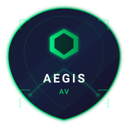
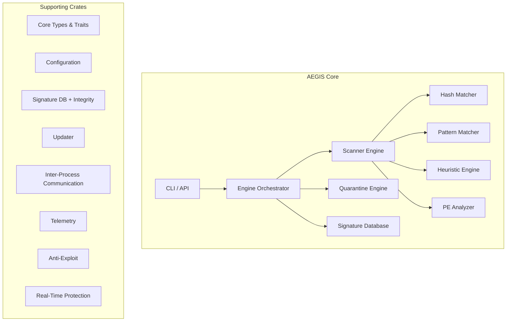

<p align="center">
  
</p>

# AEGIS AV — Professional Open-Source Antivirus Engine

[](https://www.rust-lang.org/)
[]()
[](LICENSE)
[](https://github.com/spekofc/Aegis-AV/actions/workflows/ci.yml)

---

## Overview

**AEGIS AV** is a modular, open-source antivirus engine written in Rust, designed for endpoint security research and production deployment. Built on a plugin architecture with strong separation of concerns, it provides signature-based detection, heuristic analysis, quarantine management, and a signature database with cryptographic integrity.

Unlike monolithic security products, AEGIS AV exposes every detection layer as a composable crate, enabling integration into custom security pipelines, EDR development, and security research.

---

## Architecture



---

## Feature Matrix

| Category | Feature | Status |
|----------|---------|--------|
| **Detection** | SHA-256 hash lookup | ✅ Complete |
| | Pattern matching (Aho-Corasick) | ✅ Complete |
| | Heuristic analysis (temp-dir executables) | ✅ Complete |
| | PE static analysis | ✅ Complete |
| | YARA rules | 📋 Planned |
| | ML-based classification | 📋 Planned |
| **Quarantine** | AES-256-GCM encryption | ✅ Complete |
| | Add / List / Restore / Destroy | ✅ Complete |
| | JSON metadata persistence | ✅ Complete |
| | Integrity verification on restore | ✅ Complete |
| **Signatures** | SQLite database with Merkle integrity | ✅ Complete |
| | Hash signatures | ✅ Complete |
| | Pattern signatures | ✅ Implemented |
| | CLI add/status | ✅ Complete |
| | Auto-reload on update | ✅ Complete |
| **Engine** | Orchestrator with async scanning | ✅ Complete |
| | Per-file and recursive directory scan | ✅ Complete |
| | JSON output for automation | ✅ Complete |
| | Self-test (clean + EICAR) | ✅ Complete |
| **Real-Time** | Filesystem monitor (Windows) | 📋 Planned |
| | On-access/on-execute scanning | 📋 Planned |
| **Anti-Exploit** | DEP/ASLR/SEHOP/CET enforcement | 📋 Planned |
| | ROP/JOP mitigation | 📋 Planned |
| **Updater** | Signed manifest (Ed25519) | 📋 Implemented |
| | Component-based updates | 📋 Implemented |
| | Transparency log | 📋 Implemented |
| **IPC** | ALPC / Named Pipes / Filter Port | 📋 Implemented |
| **Telemetry** | ETW provider / Metrics / Events | 📋 Implemented |
| **CLI** | scan / quarantine / signatures / status / selftest | ✅ Complete |
| | `--json` flag for all commands | ✅ Complete |
| | Human-readable + structured output | ✅ Complete |

---

## Crates

| Crate | Purpose | Lines |
|-------|---------|-------|
| `aegis-core` | Types, traits, errors, versioning | ~1,600 |
| `aegis-config` | Secure configuration, licensing | ~1,100 |
| `aegis-scanner` | Hash, pattern, heuristic, PE analysis | ~1,400 |
| `aegis-signatures` | SQLite DB, Merkle integrity, matcher | ~2,800 |
| `aegis-quarantine` | AES-256-GCM, metadata persistence | ~700 |
| `aegis-engine` | Orchestrator, async scanning | ~350 |
| `aegis-cli` | Command-line interface | ~600 |
| `aegis-updater` | Signed updates, transparency log | ~1,000 |
| `aegis-realtime` | Filesystem monitor, filter driver | ~400 |
| `aegis-antiexploit` | DEP/ASLR/CET/ROP mitigation | ~150 |
| `aegis-ipc` | ALPC, named pipes, filter port | ~200 |
| `aegis-telemetry` | ETW, metrics, structured events | ~300 |
| `aegis-test-utils` | Test fixtures, generators, assertions | ~400 |

---

## Requirements

| Tool | Version | Notes |
|------|---------|-------|
| Rust | 1.80+ | MSVC toolchain |
| Cargo | 1.80+ | Included with Rust |
| Windows | 10+ x64 | Target platform |
| OpenSSL | 3.0+ | For crypto (vendored) |

---

## Building

```bash
# Clone repository
git clone https://github.com/spekofc/Aegis-AV.git
cd Aegis-AV

# Debug build
cargo build --workspace

# Release build
cargo build --release --workspace

# Run tests
cargo test --workspace

# Format check
cargo fmt --check

# Lint
cargo clippy --workspace --all-targets --all-features
```

---

## Usage

### Basic Scan

```bash
# Scan a file
aegis.exe scan sample.exe

# Scan directory recursively
aegis.exe scan C:\samples -r

# JSON output for automation
aegis.exe scan sample.exe --json
```

### Quarantine Management

```bash
# Quarantine a detected file
aegis.exe quarantine add malware.exe "Trojan.Generic" trojan

# List quarantined items
aegis.exe quarantine list

# Restore (decrypts automatically)
aegis.exe quarantine restore <uuid> C:\restored\malware.exe

# Permanently destroy
aegis.exe quarantine destroy <uuid>
```

### Signature Database

```bash
# Show database statistics
aegis.exe signatures status

# Add signature from file
aegis.exe signatures add sample.exe "Trojan.Generic" trojan 5
```

### Status & Self-Test

```bash
# Engine and signature status
aegis.exe status

# Run self-test (clean file + EICAR)
aegis.exe selftest
```

---

## Example Output

### Scan (Human)

```
Scan Results
============
Files scanned: 1
Clean: 0
Suspicious: 0
Malicious: 1
Errors: 0

Detections:
  [MALICIOUS] EICAR-Test-File | SOME(VIRUS) | confidence: 100%
```

### Scan (JSON)

```json
[
  {
    "disposition": "Malicious",
    "threat_type": "Virus",
    "threat_name": "EICAR-Test-File",
    "confidence": 1.0,
    "engine": "Hash",
    "matched_ids": [2],
    "details": { "method": "hash" },
    "duration": { "secs": 0, "nanos": 227400 }
  }
]
```

### Quarantine List

```json
[
  {
    "id": "01a1c1ad-15a8-750b-8903-9320079eb530",
    "path": "C:\\AEGIS-AV\\data\\Quarantine\\01a1c1ad-15a8-750b-8903-9320079eb530.com",
    "original_path": "data\\eicar.com",
    "threat_name": "EICAR-Test-File",
    "threat_type": "Virus",
    "size": 63,
    "hash": [34, 28, 105, ...],
    "quarantined_at": 1794250708392085100,
    "encrypted": true
  }
]
```

### Self-Test

```
Self-test results:
  Clean file scan: PASS
  EICAR scan: PASS
All tests PASSED
```

---

## Testing

```bash
# Run all tests
cargo test --workspace

# Results: 38 tests passing across all crates
# aegis-config: 11 tests
# aegis-core: 13 tests
# aegis-scanner: 2 tests
# aegis-signatures: 10 tests
# aegis-test-utils: 2 tests
```

---

## Roadmap

| Phase | Focus | Target |
|-------|-------|--------|
| **v0.1** | Core detection engine, quarantine, signatures | ✅ Alpha |
| **v0.2** | Real-time filesystem monitor (Windows) | 📋 Planned |
| **v0.3** | Anti-exploit enforcement (DEP/ASLR/CET) | 📋 Planned |
| **v0.4** | YARA rules, ML classification | 📋 Planned |
| **v0.5** | Network scanning, behavioral analysis | 📋 Planned |
| **v1.0** | Production hardening, multi-platform | 📋 Planned |

---

## Known Limitations

- **Windows x64 only** — Linux/macOS support planned
- **No real-time protection** — filesystem monitor not yet implemented
- **Signature database empty by default** — add signatures manually or import
- **No cloud lookup** — offline-only in current alpha
- **Alpha quality** — not for production use

---

## Security

AEGIS AV is designed for legitimate security research and endpoint protection. It does not provide:

- Antivirus/EDR evasion techniques
- Malware obfuscation or persistence
- Sandbox bypass or anti-analysis for malicious purposes
- Unauthorized software cracking

See [SECURITY.md](SECURITY.md) for vulnerability reporting.

---

## Contributing

See [CONTRIBUTING.md](CONTRIBUTING.md) for guidelines on:

- Code style (`cargo fmt`, `cargo clippy`)
- Testing requirements
- Pull request process
- Architecture decisions

---

## License

AEGIS AV is licensed under the **Apache License 2.0** - see [LICENSE](LICENSE) for details.

```
Copyright 2024 AEGIS AV Project

Licensed under the Apache License, Version 2.0 (the "License");
you may not use this file except in compliance with the License.
You may obtain a copy of the License at

    http://www.apache.org/licenses/LICENSE-2.0

Unless required by applicable law or agreed to in writing, software
distributed under the License is distributed on an "AS IS" BASIS,
WITHOUT WARRANTIES OR CONDITIONS OF ANY KIND, either express or implied.
See the License for the specific language governing permissions and
limitations under the License.
```

---

## Repository

- **Source**: https://github.com/spekofc/Aegis-AV
- **Issues**: GitHub Issues
- **Discussions**: GitHub Discussions
- **Releases**: https://github.com/spekofc/Aegis-AV/releases

---

*AEGIS AV — Advanced Endpoint Security for the Modern Era*